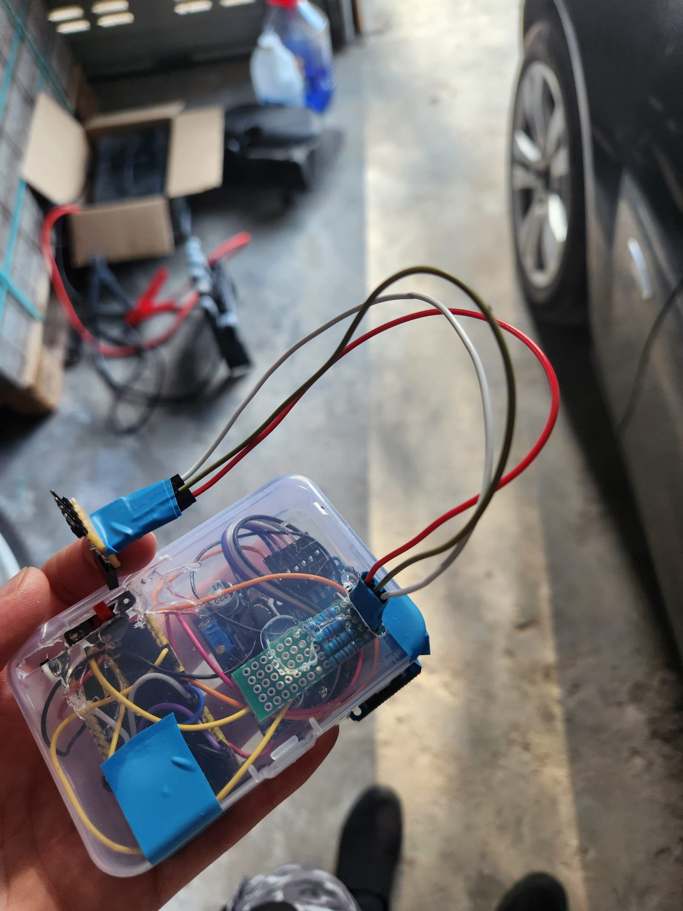

# ESP32 LIN Sniffer

A PlatformIO project for an ESP32-WROOM that monitors a LIN bus at 19,200 baud. It detects LIN frames, reports the bus status every two seconds, and records the last two data bytes for LIN ID `0x04`. It also measures the battery voltage and can log the readings to an SD card.

## Prototype



## Features

- Receives and parses LIN frames (break, sync, PID, and data).
- Detects LIN bus activity and whether a frame with target ID `0x04` was received.
- Maps the first two data bytes of the target ID to known lighting states.
- Measures battery voltage through the ADC, averaging eight readings.
- Reports status over the serial interface and optionally logs to an SD card every two seconds.

## Hardware and connections

| ESP32 pin | Connection | Notes |
| --- | --- | --- |
| GPIO 4 | LIN receive | Connect to the RXD output of a suitable LIN transceiver. |
| GPIO 34 | Battery voltage | ADC input after the voltage divider. |
| GPIO 5 | SD card CS | Chip-select for the SD card. |
| GPIO 18 | SD card SCK | VSPI clock (default pin assignment). |
| GPIO 19 | SD card MISO | Data from the SD module over VSPI. |
| GPIO 23 | SD card MOSI | Data to the SD module over VSPI. |

LIN is an automotive bus whose voltages and electrical transients can damage an ESP32. **Do not connect the LIN bus directly** to an ESP32 pin. Use a suitable LIN transceiver to convert the bus signal to an ESP32-compatible RX signal; the ESP32 and transceiver must share a common ground.

The battery voltage divider is described in the source as `VIN — 22 kΩ — GPIO 34 — 5.6 kΩ — GND`. The software uses resistor values of 21.7 kΩ and 5.5 kΩ for its calculation. The ADC voltage must remain within the ESP32's permitted input range. Check the maximum input voltage and the actual resistor values before connecting the circuit.

Use an SD module compatible with the ESP32, connected to the VSPI pins with GPIO 5 as CS.

## Build and upload

You need [PlatformIO](https://platformio.org/) with the ESP32 platform installed. The `upesy_wroom` environment is configured in `platformio.ini`.

```sh
pio run
pio run --target upload
pio device monitor
```

The serial monitor uses `115200` baud. LIN reception is configured for `19200` baud.

## Output and SD card logging

At startup, the serial interface prints the configuration. It then outputs a status line every two seconds, including LIN and lighting status, the most recently received data bytes, and the battery voltage. Lighting states are interpreted using a byte table in the source; unrecognized combinations are shown as `Unknown`.

If an SD card is initialized, the program creates the first available file from `/lin_0001.txt` through `/lin_9999.txt`. Existing files are not overwritten. Each file starts with this header (the labels are written as shown):

```text
Nr LIN Licht Data0 Data1 Interpr Batt_V
```

The following rows are space-separated. `Nr` is the line number; `LIN` and `Licht` are `1` (detected) or `0` (not detected); `Data0`, `Data1`, and `Interpr` contain the latest data for the target ID. If no matching data was received during the time window, these fields contain `--`. `Batt_V` contains the battery voltage in volts to two decimal places. If SD initialization fails, serial status output continues but SD logging is disabled.

## Project structure

- `src/main.cpp` – LIN reception and parsing, battery voltage measurement, and logging.
- `platformio.ini` – PlatformIO configuration.
- `include/`, `lib/`, `test/` – PlatformIO directories for headers, private libraries, and tests.
